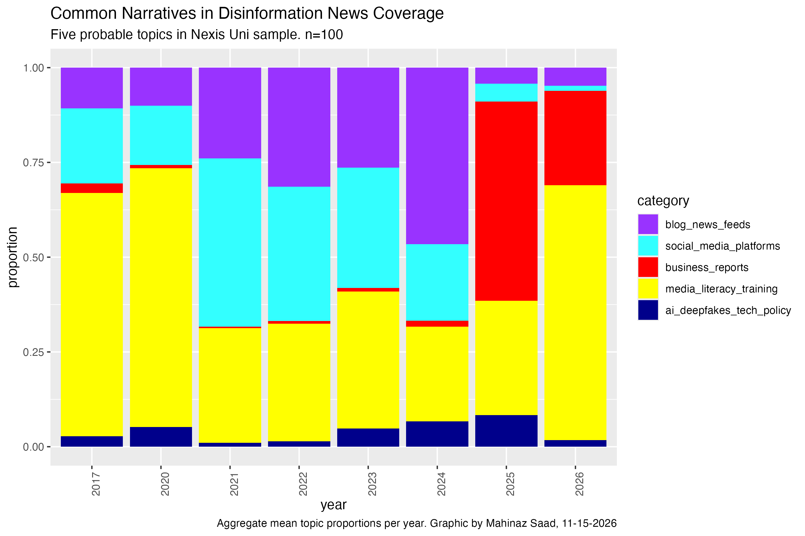

# How the News Talks About Disinformation

## From media literacy to deepfakes

This topic model analyzed 100 Nexis Uni articles about disinformation published from 2017 to 2026, to identify five topics. Three topics are relevant to how disinformation is narrated in news coverage. Media literacy training, the largest topic every year, covers UNESCO and other programs teaching journalists and youth leaders to counter disinformation, especially around COVID-19. Social media platforms, strongest from 2021 to 2024, covers the Facebook whistleblower, Twitter impersonation and congressional testimony on Big Tech. AI, deepfakes and tech policy is small but growing in 2024 and 2025, reflecting an emerging narrative about deepfake detection, deepfake pornography and AI in elections.

{width="100%"}

Two topics weren't relevant -- blog news feeds, made up entirely of Gates of Vienna roundup posts, and business reports, drawn from 2025 Canada Media industry reports that mention disinformation only in passing.

Overall, topic modeling was useful in revealing how coverage shifted from media literacy and social media toward AI and deepfakes; however, these should be treated as exploratory initial results to be refined in future work.

# Importing the data 

```{r eval=FALSE, include=TRUE}
files <- list.files("Files(100)", pattern = "\\.rtf$", ignore.case = TRUE, full.names = TRUE)

disinfo <- map_dfr(files, read_article) %>% 
  mutate(year = year(mdy(date_text))) %>% 
  filter(!is.na(year))
```

## Running the topic model

```{r eval=FALSE, include=TRUE}
minimumFrequency <- 2
DTM <- DocumentTermMatrix(processedCorpus, control = list(bounds = list(global = c(minimumFrequency, Inf))))
sel_idx <- slam::row_sums(DTM) > 0
DTM <- DTM[sel_idx, ]
textdata <- textdata[sel_idx, ]

K <- 5
set.seed(9161)
topicModel2 <- LDA(DTM, K, method="Gibbs", control=list(iter = 500, verbose = 25, alpha = 0.2))
tmResult <- posterior(topicModel2)
theta <- tmResult$topics
```

## Building the chart

```{r eval=FALSE, include=TRUE}
ggplot(vizDataFrame, aes(x=factor(year), y=value, fill=category)) + 
  geom_bar(stat = "identity") + ylab("proportion") + xlab("year") +
  theme(axis.text.x = element_text(angle = 90, hjust = 1)) +
  scale_fill_manual(values=c("#9933FF", "#33FFFF", "red", "yellow", "darkblue")) +
  labs(title = "Common Narratives in Disinformation News Coverage",
       subtitle = "Five probable topics in Nexis Uni sample. n=100",
       caption = "Aggregate mean topic proportions per year. Graphic by Mahinaz Saad, 11-15-2026")
ggsave("disinformation_topics.png", width=9, height=6, dpi=300)
```

